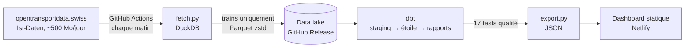
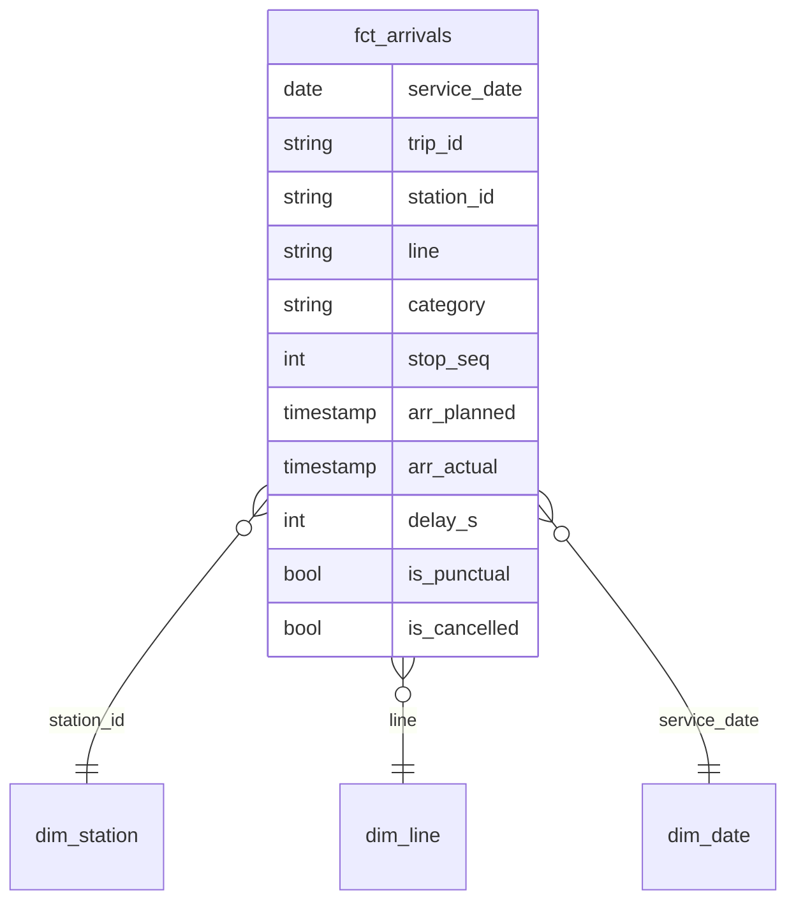

# Ponctualité des trains suisses

**Les trains suisses sont-ils vraiment à l'heure ?** Ce projet répond avec les données officielles : chaque arrivée de train en Suisse, publiée chaque jour sur [opentransportdata.swiss](https://opentransportdata.swiss), est téléchargée, modélisée en SQL et transformée en dashboard public, sans aucune intervention humaine.

**Dashboard en ligne : https://cff-ponctualite.netlify.app**

> *EN : An end-to-end, fully automated analytics project on Swiss open railway data. GitHub Actions ingests ~500 MB of raw data every morning, DuckDB reduces it to train arrivals, dbt builds a tested star schema, and a static dashboard is redeployed automatically.*

[](https://github.com/Toumil94/cff-ponctualite/actions/workflows/ci.yml)
[](https://github.com/Toumil94/cff-ponctualite/actions/workflows/daily.yml)

## Ce que montre le dashboard

- **Ponctualité globale** selon la définition des CFF : un train est ponctuel s'il arrive avec moins de 3 minutes de retard.
- **Évolution jour par jour**, avec les week-ends repérés.
- **Carte de chaleur jour × heure** : à quels moments de la semaine les retards se concentrent.
- **Comparaison des catégories** : InterCity, InterRegio, RegioExpress, S-Bahn.
- **Répartition des retards** par tranche.
- **Propagation** : comment le retard moyen évolue d'arrêt en arrêt le long d'une course.
- **Classement des gares**, triable et filtrable (Genève, Lausanne, Bern, Zürich...).

## Architecture



| Étape | Outil | Détail |
|---|---|---|
| Collecte | GitHub Actions, Python | Liste les fichiers quotidiens via l'API CKAN du portail, télécharge en flux, gère les fichiers zippés. |
| Réduction | DuckDB | Ne garde que les trains et les colonnes utiles : environ 500 Mo de CSV deviennent quelques Mo de Parquet. |
| Stockage | GitHub Releases | Un « data lake » gratuit : un fichier Parquet par jour, fenêtre glissante de 60 jours. |
| Modélisation | dbt + DuckDB | Couche staging (typage, formats de dates hétérogènes), modèle en étoile, tables de reporting. |
| Qualité | tests dbt | Unicité, non-nullité, valeurs attendues, intégrité référentielle, retards plausibles, taux de couverture. Le pipeline s'arrête si un test bloquant échoue. |
| Restitution | HTML, SVG, JavaScript | Dashboard sans dépendance, interactif (infobulles, tri, recherche), lisible sur mobile. |

## Modèle de données



- **Grain de la table de faits** : une arrivée d'un train dans une gare.
- **Retard mesuré** uniquement quand l'heure réelle a été enregistrée (statut `REAL`) ; les prévisions ne comptent pas.
- **Rapports** (`models/reports/`) : KPI, quotidien, jour × heure, catégories, gares, lignes, distribution, propagation.

## Lancer en local

```bash
pip install -r requirements.txt

# Option 1 : données fictives, pour tester en 10 secondes
python pipeline/make_sample.py

# Option 2 : vraies données des 3 derniers jours (~1,5 Go téléchargés)
python pipeline/fetch.py --days 3

cd dbt && dbt build --profiles-dir . && cd ..
python pipeline/export.py
python -m http.server -d site 8000   # puis ouvrir http://localhost:8000
```

## Structure

```
pipeline/   fetch.py (collecte), export.py (JSON), make_sample.py (données de test)
dbt/        models/staging, models/marts (étoile), models/reports, tests, macros
site/       dashboard statique + data/dashboard.json
.github/    daily.yml (mise à jour quotidienne), ci.yml (tests à chaque push)
```

## Limites connues

- La fenêtre d'analyse dépend du nombre de jours publiés par le portail et conservés dans le data lake (60 jours au maximum).
- Seuls les trains sont analysés (pas les bus, trams ni bateaux), toutes entreprises ferroviaires confondues.
- Projet indépendant, non affilié aux CFF. Les chiffres peuvent différer des statistiques officielles, qui reposent sur une méthodologie interne.

## Auteur

**Lyes Toumi**, Data & AI Engineer à Genève. [Portfolio](https://toumilyes.netlify.app) · [LinkedIn](https://www.linkedin.com/in/lyes-toumi)
